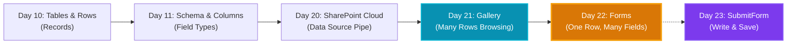
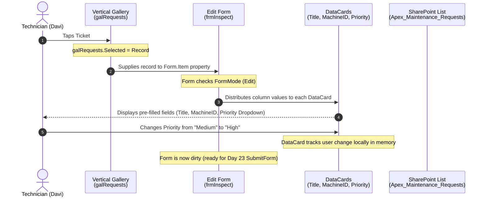

# DAY 22 TRAINER MANUAL: FORMS — ONE RECORD, MANY FIELDS
**Curriculum:** Microsoft Power Apps Professional Enterprise Foundation  
**Phase:** Phase 7: Power Apps Data Integration  
**Audience:** Absolute Zero Beginner (No prior coding, database, or logic experience)  
**Total Duration:** Exactly 90 Minutes  
**Storyline:** Apex Plastics Manufacturing — Plant Floor Maintenance & Work Order Dispatch System  
**Central Mental Model:** `REAL PROBLEM -> PROCESS -> DATA -> UI/SCREEN -> LOGIC/DECISION -> ACTION -> STORAGE -> FEEDBACK -> TEST`  
**Today's Connection Chain:** `selected/new record -> Form -> DataCards/fields -> FormMode (View / Edit / New)`

---

## 1. Measurable Learning Objectives (3-5 Measurable Outcomes)
By minute 90 of this session, an absolute zero beginner student will be able to:
1. **Explain the Core Purpose of an Edit Form:** Define in plain non-technical language why an Edit Form exists and why placing 15 loose Text Inputs on a screen is an architectural disaster.
2. **Bind Form to Data Source & Selected Record:** Correctly configure an Edit Form by pointing `DataSource` to `Apex_Maintenance_Requests` and setting `Form.Item` to `galRequests.Selected` without syntax errors.
3. **Anatomy of DataCards:** Deconstruct a DataCard into its 4 constituent parts (DataCardKey, DataCardValue, ErrorMessage, Star) and explain why unlocking a card is a deliberate architectural decision.
4. **Distinguish the 3 Form Modes:** Explain the behavioral differences between `FormMode.Edit`, `FormMode.New`, and `FormMode.View`, predicting how each mode alters user input capability and visual appearance.

---

## 2. Timed 90-Minute Agenda (Spiral Learning Flow)

| Time | Phase | Focus / Topic | Student Mental State |
| :--- | :--- | :--- | :--- |
| **00 - 08 min** | **RECALL** | Prerequisite retrieval (Days 10, 11, 20, 21) & Concept Map continuity | "I remember rows vs columns and selecting a row in a gallery." |
| **08 - 20 min** | **CONNECT & DISCOVER** | The "Why This Exists" Crisis: The 30 loose inputs disaster; Doctor's Medical Chart analogy | "I see why loose inputs fail and why a unified Form folder is essential." |
| **20 - 32 min** | **DECONSTRUCT** | Anatomy of Forms & DataCards; The Golden Property `Form.Item` | "The form isn't magic; it's a folder of cards bound to one row." |
| **32 - 45 min** | **DEMONSTRATE** | Live Trainer Walkthrough: Dropping Form, binding `DataSource`, setting `Item = galRequests.Selected` | "I see how the trainer binds a SharePoint row to the screen." |
| **45 - 65 min** | **GUIDED PRACTICE** | Hands-On Activity: Building the Apex Maintenance Inspection & Edit Screen | "I am actively building a live two-panel Master-Detail interface." |
| **65 - 75 min** | **INDEPENDENT TASK** | Mini-Task: Adding Choice fields, reordering cards, testing Mode toggles | "I can customize card layouts and switch between View and Edit modes." |
| **75 - 85 min** | **CHECK & REINFORCE** | 5 Deep Knowledge Checks (including 'Why' & 'What Happens If') | "I can articulate why `Form.Item` needs a single record, not a table." |
| **85 - 90 min** | **BRIDGE FORWARD** | Capstone synthesis & Bridge to Day 23 (`SubmitForm()` & Save) | "Today we loaded the record into the form. Tomorrow, we save changes back to SharePoint!" |

---

## 3. Prerequisite Retrieval & Concept Map Recap (5-8 min)

### Concept Map Recap


### Retrieval Questions (Trainer Cold-Call Cues)
1. **Question:** *"On Day 21, what did `galRequests.Selected` give us?"*  
   * **Target Student Answer:** It gave us the **one single record (row)** that the user tapped on in the gallery list.
   * **Trainer Connection:** *"Exactly! A gallery lets the user browse 100 rows, but when they tap one, `galRequests.Selected` isolates THAT SINGLE ROW. Today, our Form takes that exact row and lays out all 15 of its columns so we can read and edit them."*

2. **Question:** *"On Day 11, what is the difference between a table, a record, and a field?"*  
   * **Target Student Answer:** A table is the whole filing cabinet; a record is one horizontal folder (one ticket); a field is one specific piece of information inside that folder (like Machine ID or Status).
   * **Trainer Connection:** *"Brilliant! The Gallery shows the filing cabinet. Today's Form opens up that ONE folder and lays out all its fields on your desk."*

---

## 4. Today's "Why This Exists" Problem (The Workplace Crisis)

### The Workplace Scenario: Apex Plastics Maintenance Shift 2
At 08:30 AM, technician Davi selects Ticket #104 in the gallery: *"Hydraulic Valve Leaking Oil on Press P-04"*.  
The gallery row only has room to show 3 pieces of information: Title, Machine ID, and Priority.  
However, to fix the machine safely and close out the ticket, Davi needs to see and update **12 different fields**:
1. Problem Category (Choice)
2. Safety Hazard Level (Choice)
3. Temperature Reading (Number)
4. Oil Pressure PSI (Number)
5. Technician Notes (Multi-line text)
6. Parts Replaced (Text)
7. Repair Duration Minutes (Number)
8. Sign-off Technician (Person)
9. Work Completed? (Yes/No Boolean)

### The Junior Developer Nightmare
A rookie app builder attempts to build an inspection screen by manually dragging **12 separate Text Inputs, 12 separate Dropdowns, and 12 separate Labels** onto Screen 2.  
**What goes terribly wrong?**
1. **Manual Data Wiring Nightmare:** The developer has to write 12 separate complex `Default` formulas just to load the values from SharePoint.
2. **Missing Validation:** When Davi leaves "Safety Hazard" blank, the loose dropdown doesn't know it's required; no error message shows up.
3. **Saving Disaster:** When Davi taps "Save", the developer has to write a massive, 40-line `Patch()` statement matching all 12 controls. If one input name has a typo, the entire database write corrupts!
4. **Maintenance Hell:** Next week, management adds a 13th column ("Environmental Risk"). The developer has to redesign the whole screen and rewrite the saving logic from scratch.

### The Architectural Solution: Edit Form
Power Apps provides a dedicated container control: **The Form**.  
You drop a single Form, point its `DataSource` to SharePoint, and tell it: `Item = galRequests.Selected`.  
Instantly:
- All 12 columns appear formatted automatically according to their SharePoint data types.
- Numbers get numeric inputs; Choices get pre-populated dropdowns; Dates get date pickers.
- Required fields get red asterisks automatically.
- Validation and error messages are handled out-of-the-box.
- When you add a new column in SharePoint, you just check a box in Power Apps, and the field lands perfectly on the form!

---

## 5. Plain-Language Concept Before Technical Vocabulary

| Technical Term | Plain Everyday Language | What It Actually Does in the App |
| :--- | :--- | :--- |
| **Edit Form** | **A Smart Digital Folder** | A container control that inspects a SharePoint table and generates an organized set of input cards for one record. |
| **Form.DataSource** | **The Source Filing Cabinet** | Tells the form which SharePoint List schema to read and write to. |
| **Form.Item** | **The Exact Paper Folder** | Tells the form *which specific record* out of the 1,000 in the cabinet should be opened right now. |
| **DataCard** | **A Pre-Printed Form Box** | A bundled mini-layout containing the field label, the input control, the required asterisk, and the error alert for one column. |
| **DataCardKey** | **The Question / Label** | The text label at the top of the card showing the column title (e.g., "Machine ID"). |
| **DataCardValue** | **The Blank to Fill In** | The actual input control (TextBox, Dropdown, Toggle) where the user types or selects data. |
| **FormMode** | **The Folder's Lock Status** | Determines whether the fields are readable-only (`View`), editable (`Edit`), or completely blank for a brand-new ticket (`New`). |

---

## 6. Everyday Physical Analogy: The Medical Clipboard at the Doctor's Office

When you go to the hospital:
1. **The Patient Directory (Gallery):** The receptionist looks at a computer monitor listing 50 patients waiting in the lobby. She clicks your name: **Davi Santos**.
2. **The Medical Clipboard (Form):** The nurse grabs the medical clipboard folder for Davi Santos.
3. **The Pre-Printed Sections (DataCards):**
   - Section 1: *Blood Pressure* (Number card)
   - Section 2: *Known Allergies* (Choice card)
   - Section 3: *Doctor's Diagnosis* (Multi-line text card)
4. **The Three Clipboard States (FormMode):**
   - **View Mode:** Davi is in the waiting room reading his previous visit summary. He cannot scribble on it with a pen; it's protected under plastic.
   - **Edit Mode:** Dr. Alex opens the metal clip, crosses out old medication, and writes down new dosage. Existing data is visible, but can be updated.
   - **New Mode:** A brand-new patient walks into the emergency room. The nurse hands them a crisp, blank form with zero pre-filled patient info, ready to be created.

---

## 7. Visual Cause-and-Effect Architectural Diagram



---

## 8. Step-by-Step Trainer Demonstration Script

### Step 1: Insert and Position the Edit Form (Minutes 32-35)
* **Trainer Narration:** *"Watch my screen. Yesterday, we built our gallery on the left half of the canvas. Today, on the right half, we will place our detail inspection card. I click **+ Insert**, type **Edit form**, and drag it onto the right side of the screen. Notice that right now, it displays a giant grey box saying 'This form isn't connected to any data yet.' Power Apps is waiting for our instruction."*
* **Studio Action:** Set Name to `frmMaintenanceDetail`.

### Step 2: Bind DataSource & Add Fields (Minutes 35-38)
* **Trainer Narration:** *"With `frmMaintenanceDetail` selected, look at the Properties panel on the right. In the **Data source** dropdown, I select `Apex_Maintenance_Requests`. Immediately, Power Apps contacts SharePoint through our connector from Day 20. Next, I click **Edit fields**. Look! Power Apps shows all our SharePoint columns. I click **+ Add field** and check: `Title`, `MachineID`, `Priority`, `LoggedDate`, `AssignedTechnician`, and `WorkDescription`. I click Add. Instantly, 6 clean cards appear!"*

### Step 3: Wire the Golden Property: `Form.Item` (Minutes 38-42)
* **Trainer Narration:** *"Notice that right now, the form says 'No item to display.' Why? Because we told the form WHICH filing cabinet to use (DataSource), but we haven't told it WHICH FOLDER to pull out! In the property selector dropdown, I pick **Item**. In the formula bar, I write:*
  ```powerfx
  galRequests.Selected
  ```
  *Look at the magic! The moment I press Enter, the fields fill with the exact data from the first row of our gallery: 'Oil Leak on M-04', 'High Priority', 'Davi Santos'! If I hold Alt and click row 2 in the gallery, the form updates in 1 millisecond to show row 2!"*

### Step 4: Explore the 3 Form Modes (Minutes 42-45)
* **Trainer Narration:** *"Finally, look at the property called **DefaultMode**. It defaults to `FormMode.Edit`. Let's test what happens if I change it to `FormMode.View`: all the white textboxes turn into plain read-only text! If I change it to `FormMode.New`, all the fields wipe clean, ready for a fresh entry. We will control this dynamically with buttons!"*

---

## 9. Guided Practice Activity (20 Minutes)
**Task:** Build a Two-Panel Master-Detail Maintenance Console.
- **Left Panel (600px width):** `galRequests` bound to `Apex_Maintenance_Requests`.
- **Right Panel (766px width):** `frmMaintenanceDetail` bound to the same data source.
- **Item Expression:** `frmMaintenanceDetail.Item = galRequests.Selected`.
- **Fields Configured:** 5 fields formatted and ordered:
  1. Title (Text)
  2. MachineID (Text)
  3. Priority (Choice dropdown)
  4. WorkDescription (Multi-line text)
  5. LoggedDate (Date format)

---

## 10. Independent Mini-Task (10 Minutes)
**Challenge:**
1. In `frmMaintenanceDetail`, change the number of Columns from `3` to `1` or `2` in the Properties pane to make the cards stack cleanly for a tablet screen.
2. Add a toggle button above the form:
   - When Toggle is `true` &rarr; Form displays in `FormMode.Edit`.
   - When Toggle is `false` &rarr; Form displays in `FormMode.View`.
   - Formula on `frmMaintenanceDetail.DefaultMode`:
     ```powerfx
     If(tglEditMode.Value, FormMode.Edit, FormMode.View)
     ```

---

## 11. Common Misconceptions & Trainer Refutations

### Misconception 1: "The Form creates a new copy of the data."
* **Plausible Beginner Mental Model:** The student thinks the form makes a duplicate local table in the phone.
* **Trainer Refutation:** *"No. The Form is a telescope, not a photocopier. It looks directly at the row residing in SharePoint. When you type in a card, you are preparing to update that very same SharePoint row on Day 23."*

### Misconception 2: "If I want to change the label of a card, I must delete the card and make my own."
* **Plausible Beginner Mental Model:** The student cannot edit `DataCardKey.Text` because the card is locked with a padlock, so they delete the whole DataCard and drag a loose label on top.
* **Trainer Refutation:** *"Never delete a DataCard just to change a label! The padlock is a safety seal. Right-click the card and click 'Unlock to change properties'. Then you can change `DataCardKey.Text` to anything you want (even Khmer: 'លេខសម្គាល់ម៉ាស៊ីន') while keeping the database connection 100% intact!"*

### Misconception 3: "Setting `Form.Item = Apex_Maintenance_Requests` will show all tickets."
* **Plausible Beginner Mental Model:** The student puts the table name into `Item`, expecting the form to list all tickets like a gallery.
* **Trainer Refutation:** *"Remember: A Gallery holds MANY rows (Table). A Form holds ONE row (Record). If you put a table name into `Form.Item`, Power Apps throws a red error line: 'Expected Record, got Table'. A form can only open ONE folder at a time!"*

---

## 12. Five Deep Knowledge Checks (With Detailed Answers)

### Question 1 (Core Scoping):
**What is the fundamental difference in data purpose between a Gallery and a Form?**  
* **Answer:** A Gallery accepts a **Table** (many records) via `Gallery.Items` to allow browsing, filtering, and row selection. A Form accepts a **single Record** via `Form.Item` to allow inspecting and editing multiple fields of that chosen record.

### Question 2 (Architectural "Why"):
**Why does Power Apps bundle every field inside a "DataCard" instead of letting developers drop loose Text Inputs directly inside the form?**  
* **Answer:** A DataCard acts as an autonomous field coordinator. It bundles the field label, the input control, the validation check, the required red asterisk, and the database error message into one self-contained unit. If the column rules change in SharePoint (e.g., becomes required), the DataCard handles it automatically without breaking the screen layout.

### Question 3 (What Happens If):
**What happens to the Edit Form on the right if Davi clicks a different row in the gallery on the left when `Form.Item = galRequests.Selected`?**  
* **Answer:** Because Power Apps recalculates dependencies in real time, the Form immediately detects that `galRequests.Selected` has changed. In less than 1 millisecond, the form flushes the previous values and reloads the DataCards with the fields of the newly clicked row.

### Question 4 (Behavioral Comparison):
**A technician opens an incident ticket in `FormMode.View`. She taps on the Description text box, but her keyboard will not open. Why?**  
* **Answer:** `FormMode.View` locks all DataCards into read-only display mode. To allow user typing, the form's mode must be switched to `FormMode.Edit` (for updating an existing record) or `FormMode.New` (for creating a new record).

### Question 5 (DataCard Architecture):
**Inside a DataCard for a SharePoint Choice column named `Priority`, where does the dropdown control get its list of choices?**  
* **Answer:** Power Apps automatically sets the dropdown's `Items` property to:
  ```powerfx
  Choices(Apex_Maintenance_Requests.Priority)
  ```
  It queries SharePoint's metadata directly, so if an admin adds a new choice in SharePoint (e.g., "Critical / P1"), the dropdown updates automatically without needing code changes!

---

## 13. Final Capstone Challenge & Rubric
**Challenge:** Build the "Apex Emergency Work Order Inspection Station"
1. Connect `frmWorkOrder` to `Apex_Maintenance_Requests`.
2. Connect `frmWorkOrder.Item` to `galRequests.Selected`.
3. Stack 4 DataCards: Title, Equipment ID, Priority Choice, and Repair Status.
4. Unlock the Priority DataCard and verify the `Choices()` formula.
5. Provide a mode toggle button that changes the header title between "Viewing Work Order #..." and "Editing Work Order #...".

### Rubric (100 Points Total)
- **25 Pts:** Form correctly bound to `Apex_Maintenance_Requests` with zero schema errors.
- **25 Pts:** `Form.Item` bound to `galRequests.Selected` with instant reactive switching when gallery rows are clicked.
- **25 Pts:** Choice columns correctly displaying SharePoint options via `Choices()` without manual hardcoding.
- **25 Pts:** Mode switching working cleanly between `Edit` and `View` with clear UI feedback.

---

## 14. Connection Map: Past & Future
- **Day 20 (Before):** Created the pipe connecting Power Apps to the SharePoint Cloud.
- **Day 21 (Yesterday):** Used `Gallery` to pull the table of 150 rows into a browsable list.
- **Day 22 (Today):** Used `Form` to take the single selected row (`galRequests.Selected`) and display its many fields in editable cards.
- **Day 23 (Tomorrow):** We connect the `Save` button! When clicked, `SubmitForm(frmMaintenanceDetail)` sends every edited card back across the cloud pipe to write changes permanently in SharePoint.
